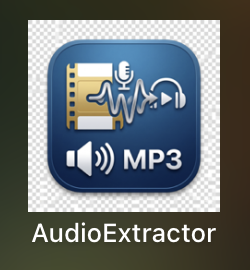
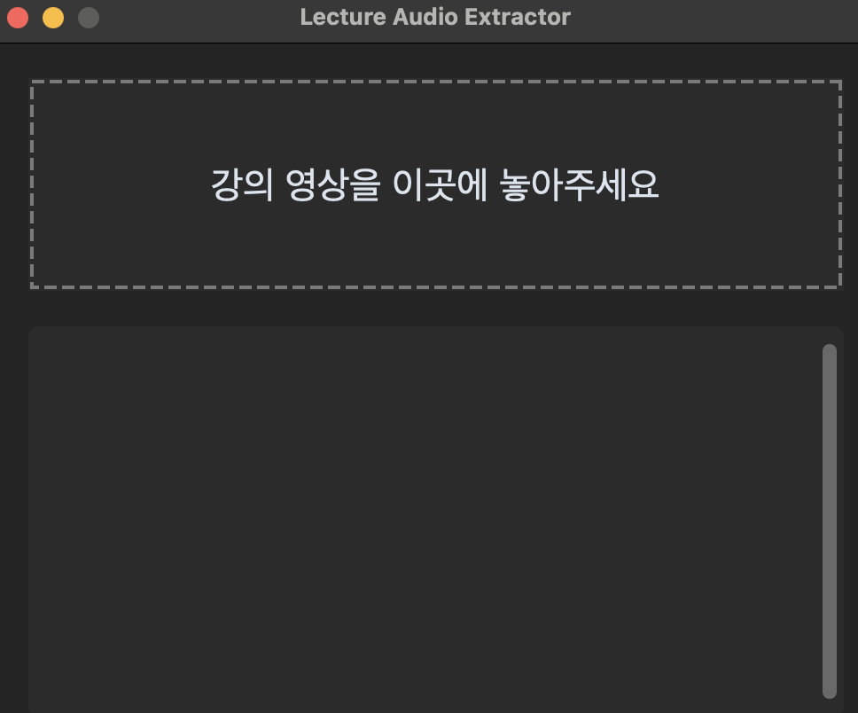
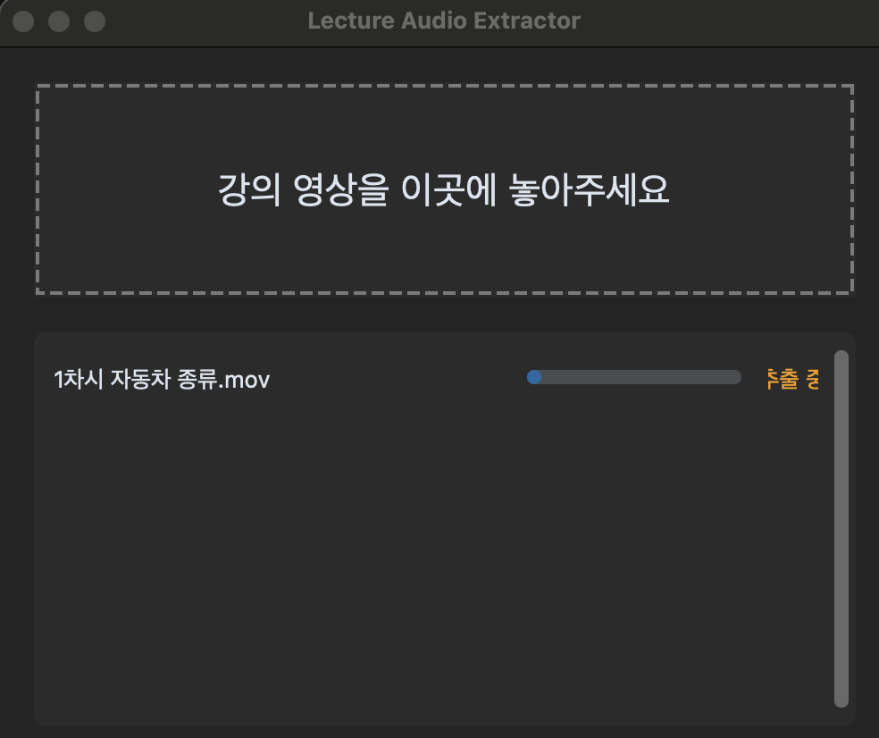
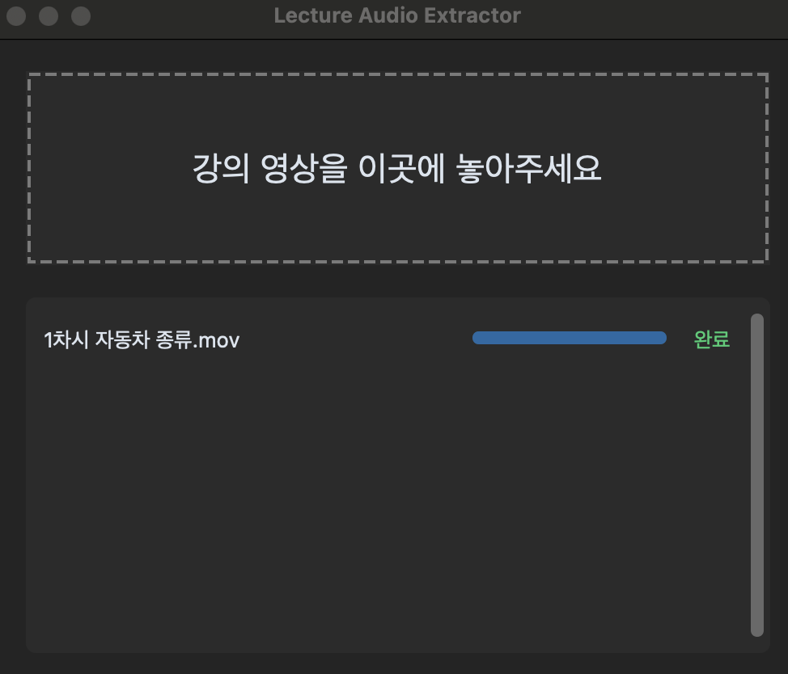

# Audio Extractor

강의 녹화 영상에서 **음성만 추출**하는 macOS 네이티브 앱 (SwiftUI + AVFoundation).

## 만든 이유

강의 영상을 LLM에 올려 텍스트로 정리하려고 하면, 영상 용량이 커서 업로드가 실패하는 경우가 있었습니다.
음성만 분리하면 용량이 크게 줄어들어 업로드와 필기 자동화가 훨씬 수월해집니다.

## 스크린샷

<p align="center">
  
</p>

| 대기 | 추출 중 | 완료 |
|:---:|:---:|:---:|
|  |  |  |

## 기능

- 영상 파일을 창에 **드래그 & 드롭** (여러 개 동시 가능), 또는 "파일 추가" 버튼으로 선택
- 여러 파일을 **순차 처리**, 파일별 **진행률** + 전체 진행률 표시
- 출력 폴더 지정 (기본값: 원본 영상과 같은 폴더)
- 완료 항목을 Finder에서 바로 열기, 완료/실패 항목 일괄 정리
- 오디오 트랙이 없는 파일 등 실패 사유를 목록에 표시
- 출력: `원본이름_audio.m4a` (AAC)

## 기술 스택

| 항목 | 내용 |
|------|------|
| 언어 | Swift 5.9 |
| UI | SwiftUI (macOS 13+) |
| 오디오 추출 | AVFoundation `AVAssetExportSession` (`AVAssetExportPresetAppleM4A`) |
| 빌드 | Swift Package Manager |
| 외부 의존성 | 없음 |

## 빌드 및 실행

요구사항: macOS 13 이상, Xcode 15 이상(또는 Swift 5.9 툴체인)

```bash
git clone <this-repo>
cd AudioExtractor
swift build -c release
.build/release/AudioExtractor
```

Xcode에서는 폴더(`Package.swift`)를 직접 열고 `Cmd+R`로 실행할 수 있습니다.

## 알려진 한계

- **입력 형식은 AVFoundation이 지원하는 컨테이너에 한정됩니다.** MP4, MOV, M4V는 정상 동작합니다.
  코드의 확장자 필터에는 mkv, avi, webm 등도 포함되어 있지만, AVFoundation이 이 컨테이너를 열지 못하면
  해당 파일은 "실패"로 표시됩니다. (ffmpeg 연동은 로드맵 참고)
- 현재 배포 형태는 Swift Package 실행 파일입니다. Launchpad 등록이나 App Store 제출에는
  앱 번들(`.app`), 서명, 샌드박스 설정이 추가로 필요합니다.

## 로드맵

- [ ] `.app` 번들 패키징 및 앱 아이콘
- [ ] App Sandbox / 코드 서명 / 공증
- [ ] ffmpeg 연동으로 mkv, avi, webm 지원
- [ ] 출력 비트레이트 선택
- [ ] 음성 → 텍스트 변환(STT)까지 한 번에 처리

## 제작 과정

개발 중 겪은 빌드 오류와 해결 과정은 [docs/DEVLOG.md](docs/DEVLOG.md)에 정리했습니다.
